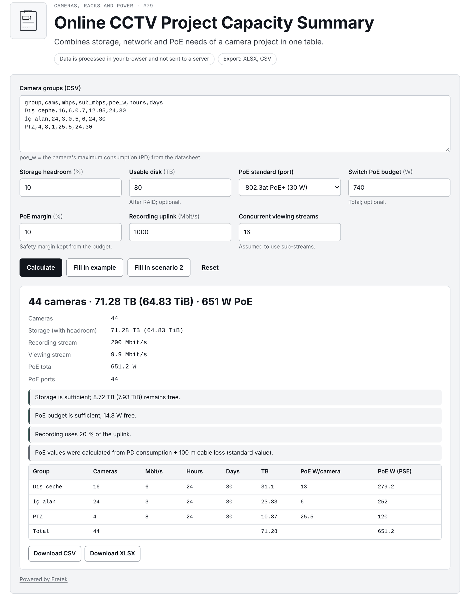

# CCTV Project Capacity Summary

Calculate recording storage, NVR bandwidth, PoE power budget and port count from camera groups at once; download as XLSX for quotes and project files.

## Try it live

- [Türkçe](https://kamera.eretek.com/araclar/cctv-proje-kapasite-ozeti)
- [English](https://kamera.eretek.com/en/tools/cctv-project-capacity)
- [Deutsch](https://kamera.eretek.com/de/werkzeuge/videoueberwachung-projektkapazitaet)



## What it does

Combines storage, network and PoE needs of a camera project in one table.

When quoting after a site survey, disk, switch and NVR choices all depend on the same camera list; when separate calculations miss a group, NVR or PoE budget falls short on site. The tool runs the engines of the CCTV Storage, CCTV Bandwidth and PoE Budget tools on the same list and returns a multi-sheet XLSX.

## Where it helps

Attach the XLSX to the quote; update the table when camera counts or bitrates change on site. Check NVR channel and decoding capacity separately with the NVR tool.

## How to use it

1. CSV header: `group, cams, mbps, days` required; `sub_mbps, poe_w, hours` optional (hours default 24).
2. Enter storage headroom and usable capacity, PoE standard, switch PoE budget and margin, uplink speed and number of concurrent viewing streams.
3. Press Run; download XLSX or CSV.

### Fields

| Field | Description |
|---|---|
| Camera groups (CSV) | poe_w = the camera's maximum consumption (PD) from the datasheet. |
| Storage headroom |  |
| Usable disk | After RAID; optional. |
| PoE standard (port) |  |
| Switch PoE budget | Total; optional. |
| PoE margin | Safety margin kept from the budget. |
| Recording uplink |  |
| Concurrent viewing streams | Assumed to use sub-streams. |

## Example input

Press **Fill in example** in the tool to load this input.

| Input | Value |
|---|---|
| Storage headroom | `10` |
| Usable disk | `80` |
| PoE standard (port) | `802.3at PoE+ (30 W)` |
| Switch PoE budget | `740` |
| PoE margin | `10` |
| Recording uplink | `1000` |
| Concurrent viewing streams | `16` |

**Camera groups (CSV)**

```text
group,cams,mbps,sub_mbps,poe_w,hours,days
Dış cephe,16,6,0.7,12.95,24,30
İç alan,24,3,0.5,6,24,30
PTZ,4,8,1,25.5,24,30
```

**Expected result:** 44 cameras: 71.28 TB storage (fits 80 TB), 200 Mbit/s recording (20 % of uplink), 651.2 W PoE (fits the 666 W left of 740 W with 10 % margin), 44 PoE ports.

## Method and assumptions

Storage uses the same formula as the CCTV Storage Calculator, PoE the same method as the PoE Budget tool (PD value + standard 100 m cable loss). Recording = Σ cameras × main Mbit/s; viewing = concurrent streams × average sub-stream (or main stream).

## Limits and common mistakes

- Ports per switch, uplink topology and NVR channel limits are not in this summary; the PoE budget assumes one switch.

## Run it locally

The tool is plain HTML, CSS and JavaScript with no build step and no dependencies.

```bash
git clone https://github.com/eretek/cctv-project-capacity.git
cd cctv-project-capacity
node scripts/serve.js        # or: python3 -m http.server 8080
```

Open <http://127.0.0.1:8080/>. Add `?lang=tr` or `?lang=de` for Turkish or German; without it the page follows the browser language and falls back to English. You can also open `index.html` directly from disk.

Run the tests (Node.js 18 or later):

```bash
node test/run.js    # or: npm test
```

The tests run the tool's own fixtures and the worked examples in all three languages without a browser.

## How it works

All processing happens in your browser. The tool makes no network requests, uses no cookies or browser storage, and does not upload files you select.

No server-side component is needed. The version on the Eretek website renders the same page through a private WordPress plugin; that plugin only produces the page markup and is not part of this repository.

| Path | Purpose |
|---|---|
| `index.html` | Page shell |
| `src/app.js` | Builds the page in Turkish, English or German from `src/data.js` |
| `src/data.js` | Field definitions, examples and all texts in three languages |
| `src/core.js` | Shared runtime: validation, number formats, result rendering, CSV/ICS export |
| `src/tool.js` | The calculation or analysis for this tool |
| `docs/screenshot.png` | Screenshot used in this README |
| `src/lib/cctv.js` | PoE and CCTV capacity engines |
| `src/lib/xlsx.js` | Minimal XLSX writer |
| `src/tools.css`, `src/page.css` | Styles |
| `test/run.js`, `test/cases.json` | Headless tests |

## License and attribution

This tool is released under the [Eretek Website Attribution License](LICENSE). You may use, modify and redistribute it, including commercially. If you make it available on a website or web application, show a visible, clickable credit linking to https://eretek.com/ on every page where the tool is available, for example:

```html
<a href="https://eretek.com/">Powered by Eretek</a>
```

You may add `rel="nofollow"` to the link. Keep the copyright notice and license text in copies and redistributions.
